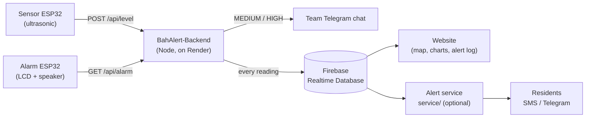

<p align="center">
  
</p>

<p align="center">
  <a href="https://j-isaac007.github.io/BahAlert"><b>Live site</b></a> ·
  <a href="#features">Features</a> ·
  <a href="#quick-start-no-hardware">Quick start</a> ·
  <a href="#connect-the-prototype-hardware">Hardware</a> ·
  <a href="#team">Team</a>
</p>

# BahAlert

BahAlert is a low-cost community flood warning system for Batangas City. Sensors above creeks and rivers measure
the water level, and an alarm sounds nearby when it rises. Residents get a warning by SMS or Telegram, and a
map-first website shows flooded areas, warns people inside a danger zone and routes them to the nearest safe zone.

**Live site:** https://j-isaac007.github.io/BahAlert

Built by team **Limang Piso** for CS Bootcamp 2026.

---

## Contents

- [Features](#features)
- [How it works](#how-it-works)
- [Tech stack](#tech-stack)
- [Repository layout](#repository-layout)
- [Quick start (no hardware)](#quick-start-no-hardware)
- [One-time setup](#one-time-setup)
- [Deploy](#deploy)
- [Connect the prototype hardware](#connect-the-prototype-hardware)
- [Resident alerts (SMS and Telegram)](#resident-alerts-sms-and-telegram)
- [Hardware](#hardware)
- [Tests](#tests)
- [Troubleshooting](#troubleshooting)
- [Team](#team)

## Features

**For residents**

- **Live flood map:** every sensor shows its colour and water level. A red sensor draws a danger zone (300 m by
  default) on the map, and a heatmap shows where flooding happens most.
- **Am I in danger?** Share your location and the site tells you whether you are inside or near a danger zone.
- **Safe route:** finds the nearest open safe zone and a walking route that goes around flooded areas.
- **Sensor pages:** water level chart, rising or falling rate, and time since the last reading.
- **Alert log**, **safe zones**, and verified **Batangas City emergency hotlines** with tap-to-call.
- **SMS and Telegram alerts:** sign up with a mobile number, pick the sensors near you, and choose how to be warned.
- Works on phones and can be installed as an app (PWA).

**For admins** (Admin, sign-in only)

- **Sensors:** see each sensor's height and thresholds, calibrate it, switch resident alerts on or off per
  sensor, and pause all alerts at once. New sensors are registered with `scripts/add-device.mjs`.
- **Safe zones** (pick the spot on a map) and **Hotlines:** keep the lists up to date.
- **Residents:** see who signed up for alerts. **Admins:** invite or remove other admins.

### What the colours mean

| Colour | Prototype level | Meaning |
|---|---|---|
| 🟢 Normal | NORMAL | Water is at a safe level. |
| 🟡 Warning | LOW | Water is rising. Get your family and documents ready. |
| 🔴 Danger | MEDIUM, HIGH | Move to a safe zone now. The area around the sensor becomes a danger zone. |
| ⚪ Offline | | No reading for 60 seconds. Do not assume it is safe. |

## How it works



1. The **sensor** measures the distance to the water and posts it to the team's backend
   ([LuanGqnt/BahAlert-Backend](https://github.com/LuanGqnt/BahAlert-Backend)).
2. The backend tells the **alarm** board when to sound, and messages the team's Telegram chat on MEDIUM or HIGH.
3. It also forwards every reading to **Firebase** as sensor `bah-001`: the live level, a reading every 5 seconds,
   and an alert whenever the colour changes. The water level is `sensorHeightCm − distance`.
4. The **website** reads Firebase in real time. No page refresh is needed.
5. The optional **alert service** watches those alerts and messages the residents who follow that sensor.

The Firebase layout every part must follow is in [docs/data-contract.md](docs/data-contract.md).

## Tech stack

| Part | Built with |
|---|---|
| Website | React 19, Vite, React Router, Mapbox GL (react-map-gl), Turf, Chart.js, vite-plugin-pwa |
| Data and sign-in | Firebase Realtime Database and Authentication, security rules in `database.rules.json` |
| Routing | Mapbox Directions, with OpenRouteService as a fallback |
| Alert service | Node 18+, firebase-admin, SMS Gateway for Android, Telegram Bot API |
| Prototype hardware | ESP32, JSN-SR04T ultrasonic sensor, 16×2 LCD, MAX98357A amp and speaker |
| Hosting | GitHub Pages (website), Render (team backend) |

## Repository layout

```
web/            React + Vite website
  src/pages/      Map, Sensor, Safe zones, Hotlines, Alerts, Get alerts, Account, About, Admin
  src/components/ map layers and popups, sensor chart, UI parts
  src/lib/        flood rules, geo and danger checks, safe routing (with tests)
service/        alert service: sign-up codes, SMS and Telegram alerts, Telegram bot
scripts/        seed sample data, simulate sensors, register a board, make an admin
firmware/       ESP32 sketches that write to Firebase directly, and team-server/ (reference copy of the link)
docs/           data-contract.md (Firebase shape), pitch-qa.md (technical Q&A), pitch-guide.md (pitch plan and judge Q&A)
design-system/  brand and UI design files
.github/        deploy to GitHub Pages, run the simulator on GitHub
```

## Quick start (no hardware)

Needs Node 18 or newer and a filled-in `.env` and `web/.env` (see [One-time setup](#one-time-setup)).

```bash
npm install                 # repo root: script dependencies
npm run seed                # sample sensors, safe zones and hotlines around Alangilan
npm run simulate            # fake sensors rise and fall every 6 minutes (Ctrl+C to stop)

cd web
npm install
npm run dev                 # http://localhost:5173
```

To test the danger warning: Chrome DevTools → ⋮ → More tools → Sensors, then set a location inside a red circle.

### Local Firebase emulator (no real database)

```bash
firebase emulators:start    # Database :9000, Auth :9099, emulator UI :4000
```

In the root `.env` use option B (the emulator lines), and in `web/.env` set `VITE_USE_EMULATORS=true`.

### Run the simulator on GitHub

The live site only shows moving sample sensors while a simulator is running somewhere. To run it on GitHub
instead of a laptop:

1. Once: repo Settings → Secrets and variables → Actions → add `FIREBASE_SERVICE_ACCOUNT` with the whole
   contents of `serviceAccount.json`.
2. **Start:** Actions → *Sensor simulator* → Run workflow → mode `start`, and pick how many minutes (max 350).
3. **Stop:** run it again with mode `stop`, or cancel the running job. Sensors show offline within 60 seconds.

Don't run it on GitHub and on a laptop at the same time, because both would write to the same sensors. The
simulator never touches the real prototype sensor `bah-001`.

## One-time setup

1. **Firebase:** create a project and enable *Realtime Database* (region asia-southeast1) and *Authentication*
   with *Email/Password* and *Anonymous* (used while a resident's sign-up code is checked). Put the project id in
   `.firebaserc`.
2. **Mapbox:** create an account and copy the default public token (`pk.…`). Restrict it by URL to
   `http://localhost:5173` and your live site.
3. **OpenRouteService** (optional): a free key from openrouteservice.org, used only when every Mapbox route
   crosses a flood zone.
4. **`web/.env`:** copy `web/.env.example` and fill in the Firebase web config, `VITE_MAPBOX_TOKEN` and
   optionally `VITE_ORS_KEY`.
5. **`.env`** (repo root, for scripts and the alert service): copy `.env.example`, set `FIREBASE_DATABASE_URL`, and
   save a service account key as `serviceAccount.json` (Firebase console → Project settings → Service accounts).
6. **Firebase CLI:** `npm i -g firebase-tools`, then `firebase login`.
7. **Security rules:** `firebase deploy --only database`.
8. **First admin:** `npm run make-admin -- you@example.com`, then open the printed link to set a password. There
   is no public sign-up: more admins are invited from Admin → Admins, and removed there or with
   `npm run make-admin -- --remove <email>`.

> **Never commit** `.env`, `web/.env`, `serviceAccount.json`, any `secrets.h` or `bahalert.config.json`. They are
> all in `.gitignore`.

## Deploy

Every push to `main` builds the website and publishes it to GitHub Pages
([.github/workflows/deploy.yml](.github/workflows/deploy.yml)). The build reads these repository secrets:
`VITE_FIREBASE_API_KEY`, `VITE_FIREBASE_AUTH_DOMAIN`, `VITE_FIREBASE_DATABASE_URL`, `VITE_FIREBASE_PROJECT_ID`,
`VITE_FIREBASE_APP_ID`, `VITE_MAPBOX_TOKEN` and `VITE_ORS_KEY`.

Security rules are deployed separately with `firebase deploy --only database`.

Firebase Hosting also works (`firebase.json` is set up for it):

```bash
cd web && npm run build && cd ..
firebase deploy --only hosting
```

## Connect the prototype hardware

**What the prototype uses now: the team's backend.** The ESP32s talk to
[BahAlert-Backend](https://github.com/LuanGqnt/BahAlert-Backend), a small Node server on Render that runs the
alarm and the team's Telegram alerts. Its `bahalert-website.js` signs in as the board account and forwards every
reading to Firebase as `bah-001`. It needs five settings, set in Render → Environment (the `.env` file is not
deployed):

| Setting | Value |
|---|---|
| `BAHALERT_API_KEY` | Firebase web API key |
| `BAHALERT_DATABASE_URL` | the Realtime Database URL |
| `BAHALERT_DEVICE_ID` | `bah-001` |
| `BAHALERT_EMAIL` | the board's login, made by `scripts/add-device.mjs` |
| `BAHALERT_PASSWORD` | the board's password (share privately, never in the repo) |

The Render logs show `[WEBSITE] link on: sending readings as bah-001` when it works. If the server logs
`link off`, a setting is missing or misspelled. `firmware/team-server/` keeps a reference copy of the same link
for a server run on a laptop.

**Other ways to connect a board**

- **Boards write to Firebase themselves (no server):** flash `firmware/bahalert_sensor/` and
  `firmware/bahalert_alarm/`. Wiring, libraries and thresholds are in [firmware/README.md](firmware/README.md).
  Register the board first:
  ```bash
  node scripts/add-device.mjs bah-001 "<name>" <barangay> <lat> <lng> --secrets firmware/bahalert_sensor/secrets.h
  ```
- **The alert service as the server:** `node service/index.mjs` with `BRIDGE_PORT=3000` serves the same
  `/api/level` and `/api/alarm` endpoints from a laptop.

**Calibrate:** once readings arrive and the channel under the sensor is empty, open Admin → Sensors →
Calibrate. The current distance becomes the sensor's height, so the water level reads 0.

## Resident alerts (SMS and Telegram)

Residents sign up on the site (Alerts → *Sign up with your number*) with their mobile number and a texted code,
pick the sensors near them, and choose SMS, Telegram or both. The alert service in `service/` sends the codes and
the alerts, and runs the Telegram bot.

1. **SMS:** on a spare Android phone with a loaded SIM, install *SMS Gateway for Android* (sms-gate.app), start
   *Cloud server*, and copy its username and password into the root `.env` as `SMS_GATEWAY_USER` and
   `SMS_GATEWAY_PASS`. Keep the phone charged and online. Without them, SMS is a dry run that only logs.
2. **Telegram:** create a bot with **@BotFather** and put its token in `.env` as `TELEGRAM_BOT_TOKEN`. Residents
   link their chat from the Account page. The bot answers `/status` and `/stop`.
3. **Run it** and leave it running on a laptop or an always-on machine (hosts that sleep when idle miss alerts):
   ```bash
   node service/index.mjs
   ```
4. **Admin → Sensors:** switch on alerts for real sensors only, and keep simulated ones off. The switch at the
   top pauses all messages.

**What residents receive**

| When | Message |
|---|---|
| Rises to yellow | BahAlert WARNING: water rising at *place*, now *N* cm. Get your family and documents ready. *link* |
| Rises to red | BahAlert DANGER: water at *place* is *N* cm and rising. Move to a safe zone now. *link* |
| Back to green | BahAlert: water at *place* is back to a safe level (*N* cm). *link* |

Red falling to yellow sends nothing. The same level for a sensor is sent at most once every 15 minutes, and every
SMS fits in one 160-character message.

## Hardware

### Production design

There are two separate units with no cable between them. Each has its own solar panel, MPPT controller, LiFePO4
battery and ESP32 in an IP65 enclosure. The **sensor unit** texts alerts over 4G and pushes readings to
Firebase. It also sends the alert to the **announcer unit** over LoRa radio, so the siren and display still work
with no cell signal.

| Unit | Main parts | Parts cost (one unit) |
|---|---|---|
| Sensor | 24 GHz radar level sensor (RS485), SIM7672G 4G modem, RFM95W LoRa, 20 W panel, 12 Ah battery | ~₱20,990 |
| Announcer | Six P10 LED panels (3 × 2), 12 V 110 dB siren and relay, RFM95W LoRa, 100 W panel, 50 Ah battery | ~₱39,600 |
| **Total** | | **~₱60,590** |

Prices are converted from US dollar online prices at ₱63.85 per $1 (BSP, 23 Nov 2026). Bought in batches of 50
to 100, a sensor unit drops to about ₱13,000–16,000 and an announcer to about ₱22,000–29,000. The full parts
list is on the About page ([web/src/pages/About.jsx](web/src/pages/About.jsx)).

### Built prototype

- **Sensor:** ESP32 with a JSN-SR04T waterproof ultrasonic sensor.
- **Alarm:** ESP32 with a 16×2 LCD, MAX98357A amplifier and speaker. It shows and sounds NORMAL, LOW, MEDIUM or
  HIGH.

Firmware for the production radar sensor, the LoRa link and the announcer unit is still to be written.

## Tests

```bash
cd web && npm test                                  # flood rules, danger checks, safe routing, phone numbers
node --test service/messages.test.mjs service/bridge.test.mjs   # alert texts, send rules, level mapping
```

## Troubleshooting

| What you see | What to do |
|---|---|
| Map says "Map disabled" | Set `VITE_MAPBOX_TOKEN` in `web/.env` and restart `npm run dev`. |
| Prototype sensor stays **Offline** | Check that the backend receives readings (`/status`) and that its log says `[WEBSITE] link on`. On Render, the five `BAHALERT_*` settings must be in Environment. |
| Water level is negative | The sensor is higher than its saved height. Use Admin → Sensors → Calibrate. |
| Sign-up code never arrives | The alert service must be running, with SMS gateway settings. Admin → Sensors shows whether it is online and whether SMS is in test mode. |
| Telegram bot doesn't answer | Check `TELEGRAM_BOT_TOKEN` and that `node service/index.mjs` is running. |
| A page 404s after refresh on GitHub Pages | The deploy copies `index.html` to `404.html`. Re-run the deploy workflow. |

## Team

**Limang Piso**, CS Bootcamp 2026

| Member | Role |
|---|---|
| Edzel | Team lead, quality checker |
| Isaac | Full-stack developer |
| Luan | Hardware |
| Aifa | Product, pitcher |
| Christian | Paper, pitcher |
